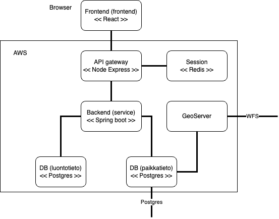

<!--
SPDX-FileCopyrightText: 2023-2024 City of Espoo

SPDX-License-Identifier: LGPL-2.1-or-later
-->

# Luontoselvitysportaali

A tool for handling nature knowledge reports (luontoselvitysraportti).

## Technical overview




## Local environment and development

### Requirements

- Docker or similar
- Docker-Compose
- Node.js (recommended setup using NVM)
- yarn
- Java JDK (21+)

### Compose

To start database and redis
- `cd compose`
- `docker-compose up -d`

### Service

To start service in http://localhost:8080
- `cd service`
- `./gradlew bootRun`

To run unit/integration tests (requires DB running through compose)
- `./gradlew test`

To run E2E tests (requires DB, api-gateway and frontend running)
- `./gradlew e2eTest`

To format code
- `./gradlew ktfmtFormat ktlintFormat`

### API-gateway

To start API-gateway in http://localhost:3000
- `cd api-gateway`
- `yarn`
- `yarn dev`

To lint and format code
- `yarn lint:fix`

### Frontend

To start frontend in http://localhost:9000
- `cd frontend`
- `yarn`
- `yarn dev`

To lint and format code
- `yarn lint:fix`

### GeoServer

See [GeoServer README](geoserver/README.md)

## Deployment

Only `master` and `deploy/<topic>` branches push images to Amazon ECR and start the deploy jobs for staging and production. The deploy jobs wait for approval in the environments that require it; approve only the environment you mean to deploy to.

To deploy a commit that is not the latest `master`, for example a pull request branch or an older version to roll production back to, push it to a `deploy/` branch:

```sh
git push --force origin <commit>:refs/heads/deploy/<topic>
```

`--force` lets an older or unrelated commit replace the one on the branch. The `prod` environment accepts deployments from `master` and `deploy/*` only, so a new branch pattern has to be added there too.

## License

luontotieto is published under **LGPL-2.1-or-later** license. Please refer to
[LICENSE](LICENSE) for further details.

### Bulk-licensing

Bulk-licensing is applied to certain directories that will never contain
anything but binary-like files (e.g. certificates) with
[a DEP5 file](./.reuse/dep5) (see
[docs](https://reuse.software/faq/#bulk-license)).

### Check licensing compliance

This repository targets [REUSE](https://reuse.software/) compliance by utilizing
the [reuse CLI tool](https://git.fsfe.org/reuse/tool) and the
[REUSE API](https://api.reuse.software/).

The REUSE API constantly checks this repository's compliance and the status
can be seen from the badge at the top of this README.

To manually check that the repository is compliant (e.g. before submitting a pull
request), run:

```sh
./bin/add-license-headers.sh --lint-only
```

**NOTE:** The tool has no concept for "no license" -> all files must indicate
their license explicitly (or using bulk licensing). And if files cannot be
licensed, they shouldn't be included in this repository at all.

### Automatically add licensing headers

To **attempt** to automatically add licensing headers to all source files, run:

```sh
./bin/add-license-headers.sh
```
