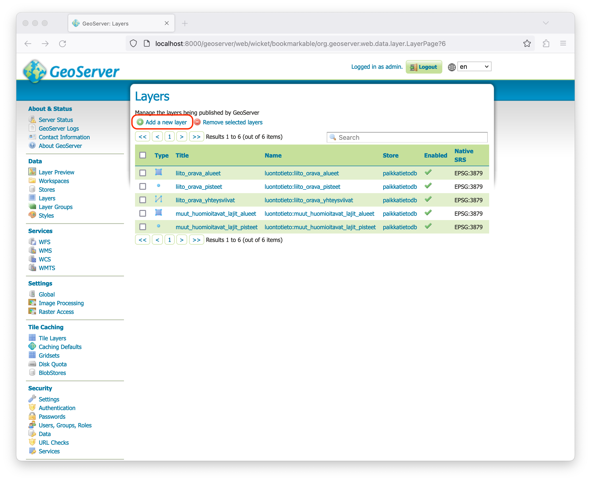
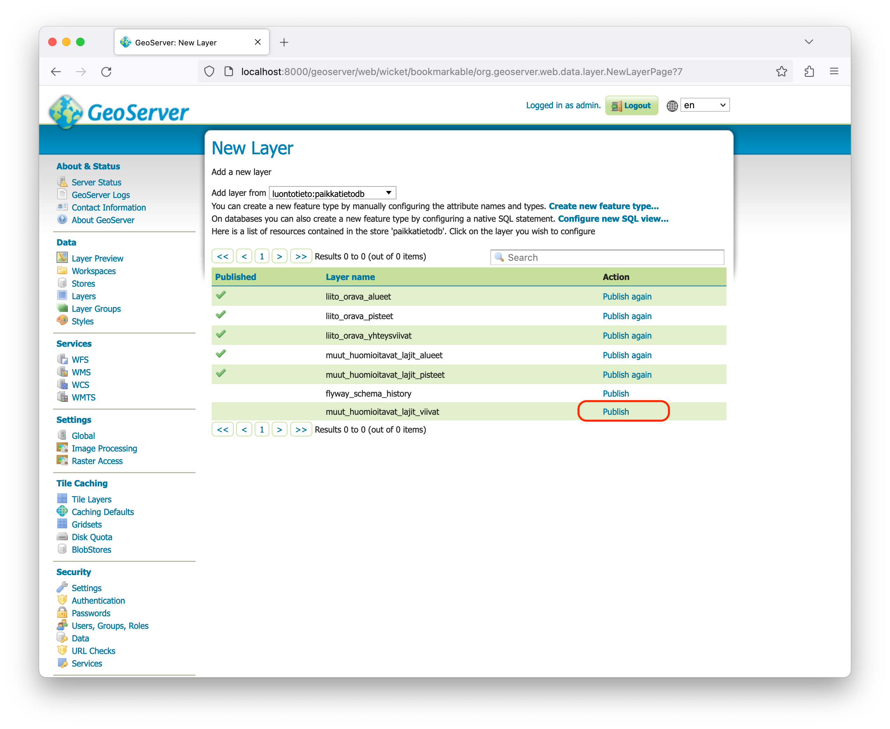
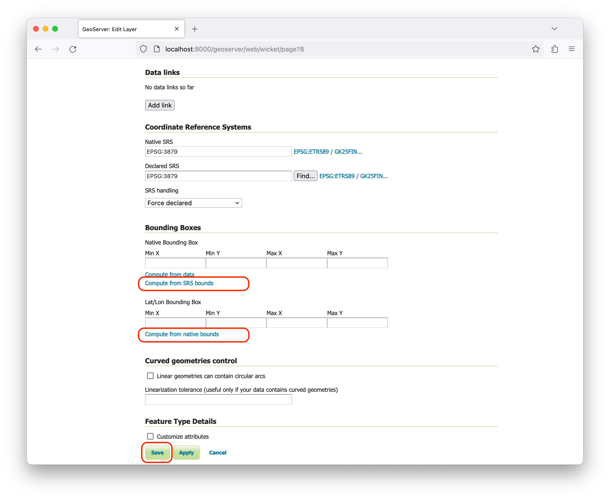

<!--
SPDX-FileCopyrightText: 2023-2024 City of Espoo

SPDX-License-Identifier: LGPL-2.1-or-later
-->

# Luontotietoportaali WFS-endpoint (GeoServer)

This directory `./geoserver` contains:

- `Dockerfile` to create a customized GeoServer installation for Luontotietoportaali WFS-service
- `./geoserver/data_dir` GeoServer's data directory with relevant configurations. This directory is fully copied into the built Docker-image.

## Instructions

### Environment variables

```
SKIP_DEMO_DATA: true                            # Skip Geoserver demo data, should be true in production
POSTGRES_JNDI_ENABLED: true                     # Enable JNDI, should be true in production
POSTGRES_HOST: paikkatieto-db                   # Hostname
POSTGRES_PORT: 5432                             # Port
POSTGRES_DB: paikkatietodb                      # Database
POSTGRES_USERNAME: paikkatietodb                # Username
POSTGRES_PASSWORD: postgres                     # Password
EXTRA_JAVA_OPTS: -DALLOW_ENV_PARAMETRIZATION=true -DGEOSERVER_CONSOLE_DISABLED=true -Xms256m -Xmx512m
GEOSERVER_ADMIN_PASSWORD: password              # Plain password, hashed by update_credentials.sh on startup
GEOSERVER_WFS_PASSWORD: wfs_password            # Plain password, hashed by update_credentials.sh on startup
GEOSERVER_WFS_USER: wfs                         # Optional user name for the automated WFS login
```

### Passwords

`update_credentials.sh` hashes the password values exactly as given (SHA-256 digest), so pass the
plain password without a `plain:` or `digest1:` prefix. A prefixed value would become part of the
password. The e2e tests (`service/src/e2eTest/.../GeoserverWfsTest.kt`) log in with both users
against the compose GeoServer.

### Layer configuration

1. Navigate to GeoServer Admin UI in `http://localhost:8000/geoserver`. Username is `admin` and password can be found from `compose/docker-compose.yml`

2. Open _Layers_ view and click _+ Add a new layer_
   

3. Publish the layer
   

4. Configure the layer.

   - _Compute from SRS bounds_ (calculates layer bounds)
   - _Compute from native bounds_ (calculate native layer bounds)
   - _Save_ after bounds have been calculated.
     

5. Commit changes in `geoserver/*` to Git.

The GeoServer entrypoint calls `/opt/update_credentials.sh` before Tomcat starts. The script rewrites the admin credentials and, when `GEOSERVER_WFS_PASSWORD` is configured, appends or refreshes the `GEOSERVER_WFS_USER` entry so that the dedicated WFS login survives every restart; keep the checked-in `users.xml` in sync with the environment variables above to keep that process deterministic.
